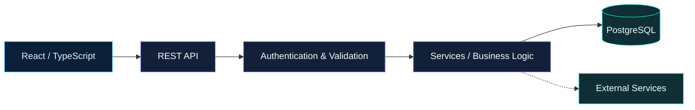

<!-- JOSEABH · GitHub Profile README -->

  

  

    

  

  
  
  

---

## `01` · About me

<table>
  <tr>
    <td width="61%" valign="top">
      <h3>Hi, I'm José Alberto</h3>
      
Estudiante avanzado de <strong>Ingeniería en Sistemas de Información</strong> en la <strong>Universidad Nacional de Costa Rica (UNA)</strong>, con interés en el desarrollo de aplicaciones web y la ingeniería de software.

      
Disfruto trabajar en diferentes etapas de un sistema: desde la interfaz y la experiencia del usuario hasta las APIs, la lógica de negocio y las bases de datos.

      
Mi stack principal incluye <strong>React, TypeScript, Node.js, NestJS y PostgreSQL</strong>. Valoro las soluciones claras, el código mantenible y una arquitectura que permita seguir evolucionando.

      
<em>Comprender el problema, diseñar con intención y construir soluciones útiles.</em>

    </td>
    <td width="39%" valign="middle">
      <h4>developer.config</h4>
      <pre><code>name: Jose Alberto Baltodano
handle: JoseABH
location: Costa Rica
education: UNA
role: Full Stack Developer

interests:
- Software Architecture
- Web Development
- Cloud & DevOps
- System Integration</code></pre>
</td>
  </tr>
</table>

---

## `02` · Engineering Stack

<table width="100%">
  <tr>
    <td align="center" valign="top" width="50%">
      <h3>Languages</h3>
      Programming & Web
        
      
        
    </td>
    <td align="center" valign="top" width="50%">
      <h3>Frameworks & Runtime</h3>
      Web applications & UI
        
      
        
    </td>
  </tr>
  <tr>
    <td align="center" valign="top" width="50%">
      <h3>Development Tools</h3>
      Workflow & design
        
      
        
    </td>
    <td align="center" valign="top" width="50%">
      <h3>Databases</h3>
      Storage & data services
        
      
        
    </td>
  </tr>
  <tr>
    <td align="center" colspan="2" valign="top">
      <h3>Cloud & Deployment</h3>
      Infrastructure & delivery
        
      
        
    </td>
  </tr>
</table>

Core: TypeScript · React · NestJS · Node.js · REST APIs &nbsp;|&nbsp; Interests: Architecture · Data · Security · Cloud

---

## `03` · What I build

<table>
  <tr>
    <td width="50%" valign="top">
      <h3>01 / Web interfaces</h3>
      
Interfaces responsivas, componentes reutilizables y experiencias que conectan el diseño con las necesidades del usuario.

      <code>React</code> <code>TypeScript</code> <code>Tailwind CSS</code>
    </td>
    <td width="50%" valign="top">
      <h3>02 / Backend & APIs</h3>
      
Servicios, endpoints, validaciones y lógica de negocio con responsabilidades claras e integración entre módulos.

      <code>NestJS</code> <code>Node.js</code> <code>REST</code>
    </td>
  </tr>
  <tr>
    <td width="50%" valign="top">
      <h3>03 / Data modeling</h3>
      
Diseño de entidades, relaciones y consultas para organizar datos y asegurar su consistencia.

      <code>PostgreSQL</code> <code>MySQL</code> <code>SQL</code>
    </td>
    <td width="50%" valign="top">
      <h3>04 / Integration & deployment</h3>
      
Conexión de aplicaciones y servicios, configuración de entornos y procesos de despliegue.

      <code>Git</code> <code>Docker</code> <code>Supabase</code> <code>Vercel</code>
    </td>
  </tr>
</table>

---

## `04` · Architecture mindset

Un ejemplo conceptual de cómo pueden integrarse las diferentes capas de una aplicación; no describe una implementación específica.

---

## `05` · Development focus

<table>
  <tr>
    <td width="50%" valign="top">
      <h3>Full Stack Development</h3>
      
<em>From interface to infrastructure</em>

      
Desarrollo de soluciones web que integran interfaces, servicios backend y bases de datos, con atención a la organización de sus componentes.

      
<strong>Áreas de interés</strong>

      <ul>
        <li>Aplicaciones web responsivas</li>
        <li>APIs y lógica de negocio</li>
        <li>Persistencia de información</li>
        <li>Integración entre servicios</li>
      </ul>
      <code>React</code> <code>TypeScript</code> <code>Node.js</code> <code>SQL</code>
    </td>
    <td width="50%" valign="top">
      <h3>Software Engineering</h3>
      
<em>Architecture, quality & maintainability</em>

      
Interés en construir software organizado, con responsabilidades definidas y soluciones que puedan evolucionar y mantenerse.

      
<strong>Áreas de interés</strong>

      <ul>
        <li>Arquitectura de software</li>
        <li>Modelado de bases de datos</li>
        <li>Seguridad y validación</li>
        <li>Automatización y despliegue</li>
      </ul>
      <code>Architecture</code> <code>Databases</code> <code>Git</code> <code>Docker</code>
    </td>
  </tr>
</table>

  

---

## `06` · GitHub analytics

  <table width="100%">
    <tr>
      <td width="50%" align="center" valign="middle"></td>
      <td width="50%" align="center" valign="middle"></td>
    </tr>
  </table>

  

  

  
<strong>View detailed GitHub metrics</strong>

   
  

    
     
    
    
     
    
    
  

Metrics depend on third-party services and GitHub's publicly accessible data. Language statistics do not indicate proficiency.

---

## `07` · Achievements

  

---

## `08` · Contribution animation

  <!-- Requires .github/workflows/github-snake.yml and a generated output branch -->
  <picture>
    <source media="(prefers-color-scheme: light)" srcset="https://raw.githubusercontent.com/JoseABH/JoseABH/output/github-contribution-grid-snake.svg" />
    
  </picture>

---

## `09` · Connect

  
<strong>Let's connect and share ideas about software development.</strong>

  <table>
    <tr>
      <td align="center" width="54"></td>
      <td width="355"><a href="https://github.com/JoseABH"><strong>GitHub</strong> · @JoseABH</a></td>
    </tr>
    <tr>
      <td align="center"></td>
      <td><a href="https://www.instagram.com/josealbertobaltodano/"><strong>Instagram</strong> · @josealbertobaltodano</a></td>
    </tr>
    <tr>
      <td align="center"></td>
      <td><strong>Facebook</strong> · Jose Alberto Baltodano</td>
    </tr>
    <tr>
      <td align="center"></td>
      <td><a href="mailto:joseabh2004@gmail.com"><strong>Email</strong> · joseabh2004@gmail.com</a></td>
    </tr>
  </table>

   
  JOSEABH / SOFTWARE DEVELOPMENT / COSTA RICA
    
  
    
  

